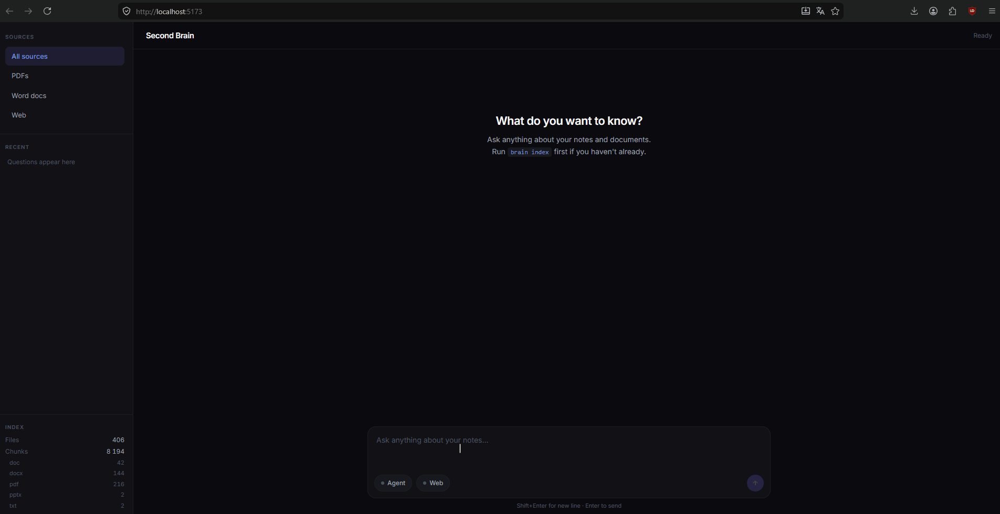
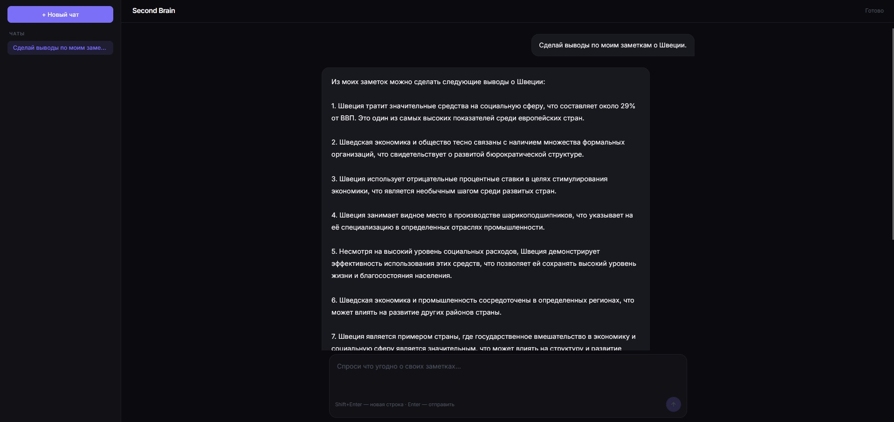

<h1 align="center">Second Brain</h1>

<p align="center">


</p>

Полностью локальный, двуязычный (русский/английский) инструмент для поиска по личным заметкам на основе RAG (Retrieval-Augmented Generation). Индексирует документы (`.docx`, `.pdf`, `.txt` и другие форматы) и позволяет задавать по ним вопросы на естественном языке. Всё обрабатывается на локальной машине через Ollama — никакие данные не покидают компьютер.

## Основной функционал и особенности:

*   **Локальность и приватность** — весь пайплайн (парсинг, эмбеддинги, векторный поиск, генерация ответа) работает оффлайн, без обращения к внешним API;
*   **Двуязычный кросс-языковой поиск** — вопрос на одном языке находит и обрабатывает заметки на другом за счет мультиязычной модели эмбеддингов и расширения запроса через LLM;
*   **Гибридный поиск** — комбинация семантического поиска (векторы) и точного поиска по ключевым словам, с приоритизацией сигналов: URL/домены, имена файлов, годы, тематические папки;
*   **Два режима работы** — прямой (retrieve → synthesise) и агентный (цикл с вызовом инструментов, включая опциональный поиск в интернете);
*   **Синтез ответа с указанием источников** — ответ собирается только из найденных фрагментов, с ссылками на документы-источники; для больших наборов используется map-reduce синтез;
*   **Поддержка множества форматов** — `.docx` (в т.ч. зашифрованные), `.doc`, `.pdf` (с OCR для сканов), `.txt`, `.csv`, `.html`, `.epub`, `.pptx`;
*   **Фильтрация через `.brainignore`** — справочные материалы можно исключить из общей выдачи, оставив доступными по прямому запросу имени файла;
*   **CLI для индексации и отладки** — команды `index`, `watch`, `stats`, `grep`, `search-test` и другие;
*   **Веб-интерфейс** — чат на React + Vite + Tailwind с потоковой выдачей ответа и отображением источников.

<div></div>

<details>
<summary>Статичный скриншот интерфейса</summary>

</details>

## Архитектура

Пайплайн разделен на два независимых этапа — индексацию и поиск:

**Индексация:** документы парсятся под каждый формат (расшифровка `.docx`, OCR для сканов `.pdf`), разбиваются на фрагменты (chunks), кодируются мультиязычной моделью эмбеддингов и сохраняются в двух хранилищах — векторы в **ChromaDB**, а сырой текст и метаданные в **SQLite** (через SQLAlchemy). Инкрементальная индексация по контрольным суммам не обрабатывает неизмененные файлы.

**Поиск:** запрос проходит через `Retriever`, который выбирает стратегию по сигналам в тексте (точный поиск по ключевым словам, поиск по имени файла, по году, по тематической папке, либо семантический поиск с расширением запроса). Найденные фрагменты передаются в `Synthesiser`, который через локальную LLM (**Ollama**) собирает из них ответ на языке вопроса. `Agent` добавляет агентный режим с циклом вызова инструментов.

Бэкенд на **FastAPI** отдает результат потоком (streaming), фронтенд на **React** отображает ответ по мере генерации.

## Стек

**Бэкенд:** Python, FastAPI, ChromaDB, SQLite / SQLAlchemy, sentence-transformers (`paraphrase-multilingual-MiniLM-L12-v2`), Ollama (`qwen2.5:7b`), Typer (CLI)

**Фронтенд:** React, Vite, Tailwind CSS

**Парсинг:** python-docx, pdfminer, pytesseract (OCR), python-pptx, langchain-community loaders

## Установка и запуск

Требуется установленный [Ollama](https://ollama.com) и Python 3.10+.

```bash
# 1. Установить зависимости
pip install -r pyproject.toml

# 2. Загрузить модель (по умолчанию — qwen2.5:7b)
ollama pull qwen2.5:7b

# 3. Настроить окружение
cp .env.example .env
# при необходимости отредактировать .env

# 4. Проиндексировать папку с документами
brain index "/path/to/your/documents"

# 5. Запустить бэкенд (без --reload)
uvicorn brain.api.main:app --port 8000

# 6. Запустить фронтенд
cd ui && npm install && npm run dev
```

Опционально — исключить справочные материалы из выдачи:
```bash
cp .brainignore.example .brainignore

```

## Примеры запросов

Программа лучше всего работает с конкретными, «заякоренными» запросами — где есть год, имя файла, домен сайта, название или другое опорное слово:

*   *«What articles have I read from `<site>`?»* — находит сохраненные ссылки с заметками и собирает их в список;
*   *«Чем я занимался в `<год>` году? Дай краткую справку.»* — собирает сводку из заметок за конкретный год;
*   Вопрос на английском по русскоязычной заметке (и наоборот) — демонстрирует кросс-языковой поиск: система находит фрагмент на одном языке и отвечает на языке вопроса;
*   *«Sum up my notes on `<тема/название>`.»* — извлекает и суммирует упоминания конкретной темы или произведения по всем документам.

## Планы развития

*   **Chunking с учетом структуры** — разбиение документов по границам заметок (даты, заголовки), чтобы длинная однотемная заметка становилась цельной единицей поиска;
*   **Более сильная модель эмбеддингов** — переход на модель уровня BGE-M3 или multilingual-e5 для лучшего ранжирования разреженных и кросс-языковых упоминаний;
*   **Отдельная коллекция для справочной литературы** — индексация большой библиотеки книг в независимое хранилище с маршрутизацией запросов, чтобы не смешивать личные заметки и внешние источники;
*   **Расширенная поддержка смены LLM** — вынесение промптов в конфигурацию для упрощения перехода на другие модели.